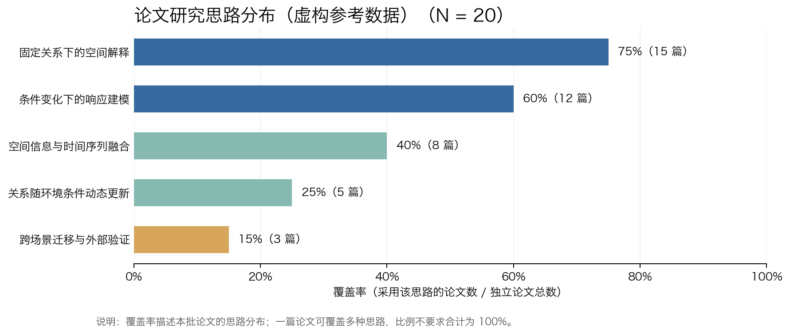

# purpose-driven-introduction

用于**多篇文献横向综合、研究思路分布分析与 Introduction 组织**的 skill。

它通过分工角色读取同主题论文，建立“文献 × 研究思路”证据矩阵，默认首先展示基于当前文献计算的覆盖率分布图，再解释常用与较少采用的思路、共同科学问题、各路线已有答案和后续研究建议，最后按需生成 Introduction 主线和逐段提纲。

> 本 skill 用于多篇文献的横向综合，不用于单篇精读。覆盖率描述本批论文的分布，不是创新概率或研究成功概率。

## 核心工作流程

```text
多篇论文或文献解读
      ↓
01 文献证据提取：去重、处理链、证据位置
      ↓
02 思路与分布分析：证据矩阵、覆盖率、分布图
      ↓
03 科学问题综合：已有答案、剩余问题、路线联系
      ↓
04 后续研究建议：新增考虑、验证方式、边界风险
      ↓
05 Introduction 组织（按需）：主线与逐段结构
```

“分布图最先出现”指**回复的展示顺序**。实际运行时必须读完论文并建立矩阵后才能绘图，不能为了先出图而猜分类或数值。

## 参考分布图



此图使用**虚构参考数据**，只展示图形样式。每次分析新论文时，思路名称、N、篇数和百分比均由当前材料重新计算。

## 能做什么

- 从多篇论文中归纳共同科学问题。
- 比较论文的切入点、假设、对象与关系表示、条件处理、信息连接和验证证据。
- 建立文献 × 研究思路证据矩阵，保留 `1 / 0 / ? / R` 及来源位置。
- 默认生成研究思路覆盖率分布图，区分常用与较少采用的思路。
- 解释不同路线的互补、衔接与递进关系。
- 提出有文献依据、可检验且带边界说明的后续研究建议。
- 按指定方向组织 Introduction，例如“空间—时空—动态时空”或“点—线—面”。
- 输出逐段 Introduction：主题句、展开论点、文献依据和过渡句。

## 仓库结构

```text
purpose-driven-introduction/
├── SKILL.md                              # 主控流程与输出规范
├── README.md                             # 安装和使用说明
├── agents/
│   ├── README.md                         # 子智能体协作说明
│   ├── 01-evidence-extractor.md          # 文献证据提取
│   ├── 02-approach-distribution-analyst.md # 思路矩阵与分布图
│   ├── 03-scientific-question-synthesizer.md # 科学问题与路线联系
│   ├── 04-research-opportunity-advisor.md # 后续研究建议
│   └── 05-introduction-architect.md      # Introduction 组织
├── assets/
│   ├── reference-distribution.png        # 虚构数据的参考图
│   └── reference-distribution.json       # 绘图输入示例
├── references/
│   └── output-template.md                # 默认输出结构
└── scripts/
    └── plot_distribution.py              # 从真实统计 JSON 绘图
```

`agents/` 中的 description 文档是角色执行契约，不绑定特定 agent 平台。支持子智能体的环境可以按角色调用；不支持时，由主智能体按同一顺序执行，不伪称启动了独立进程。

## 安装

将整个 `purpose-driven-introduction` 文件夹放入你的 agent 或客户端所使用的 skills 目录，并确保 `SKILL.md` 位于该文件夹根目录。

不同客户端的 skills 目录和加载方式可能不同，请以所用客户端的说明为准。安装后重新加载 skills，使客户端能够识别 `purpose-driven-introduction`。

## 如何使用

### 1. 默认：完整横向综合

上传同一主题的多篇论文或文献解读，然后输入：

```text
请使用 purpose-driven-introduction 分析这些论文。
```

默认依次输出：

1. 当前论文研究思路分布图；
2. 常用与较少采用的思路及解释；
3. 共同科学问题、已有答案和剩余问题；
4. 2—3 条后续研究建议；
5. 简洁的文献 × 研究思路矩阵。

### 2. 重点查看研究思路分布

```text
请使用 purpose-driven-introduction，统计这批论文不同研究思路的覆盖率，说明常用和不常用思路分别怎样处理问题。
```

覆盖率计算方式：

```text
某思路覆盖率 = 实际采用该思路的独立论文数 / 独立论文总数 N × 100%
```

一篇论文可以覆盖多种思路，因此各列覆盖率之和可以超过 100%。低覆盖率不自动等于创新，高覆盖率也不自动等于没有研究价值。

### 3. 获取科学问题和后续研究建议

```text
请使用 purpose-driven-introduction，在分布图之后归纳共同科学问题、各思路已经回答了什么，并提出后续可以怎么做的建议。
我的研究目的是：……
```

建议会写清对应问题、研究思路、文献依据、验证方式和边界风险，而不是只给“可以进一步融合”“可以提高精度”等泛化表述。

### 4. 组织 Introduction

```text
请使用 purpose-driven-introduction，先生成本批论文的思路分布图，再结合我的研究目的组织 Introduction，给出论证主线和逐段详细提纲。
我的研究目的是：……
我的研究方案或工作是：……
```

如果本批论文已经完成分析，可直接复用已有图和矩阵。自身方法或结果未提供时，skill 会先完成已有信息支持的引言结构，并标明自身工作待补。

### 5. 按指定主线组织 Introduction

```text
请使用 purpose-driven-introduction，按照“空间—时空—动态时空”的方向综合这些文献，先展示实际分布，再组织 Introduction 主线和逐段提纲。
我的研究目的是：……
```

skill 会保留指定方向，用文献中的实际方法事实界定各层含义，并说明层间递进或并列汇合的理由。

## 使用绘图脚本

绘图脚本需要 Python 和 Matplotlib。准备如下 JSON：

```json
{
  "title": "研究思路覆盖率",
  "sample_size": 20,
  "approaches": [
    {"name": "思路 A", "count": 15},
    {"name": "思路 B", "count": 8}
  ]
}
```

运行：

```bash
python scripts/plot_distribution.py input.json output.png
```

`sample_size` 是去重后的独立论文数，`count` 必须来自当前证据矩阵。图、表和正文必须使用同一份统计结果。

## 建议提供的材料

- 同一研究主题下的多篇论文、可访问文本或文献解读；
- 自己的研究目的；
- 已知的研究对象、条件和拟解决的问题；
- 自己的方法、结果或预期贡献（如已有）；
- 希望采用的组织方向（如已有）。

## 当前状态

当前版本已形成“主控 skill + 5 个角色契约 + 参考图 + 可复用绘图脚本 + 输出模板”的完整雏形。后续仍需通过多组真实文献测试分类稳定性、证据归属、分布计算和研究建议质量，再依据测试结果迭代。
