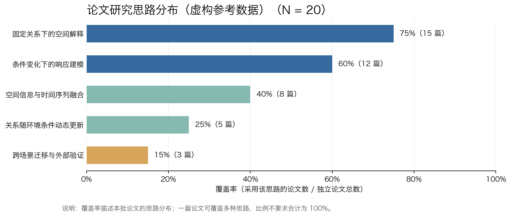

# 参考图与示例数据

## 论文研究思路分布参考图



此图使用**虚构参考数据**，只展示默认图形样式，不代表任何真实论文集合的统计结果。

每次分析新论文时，必须重新完成文献去重、思路判据定义和证据矩阵编码，再根据当前矩阵计算：

- 思路名称；
- 独立论文数 N；
- 各思路覆盖篇数；
- 覆盖率百分比。

不得直接沿用此参考图的分类或数值。

## 文件

- `reference-distribution.png`：参考分布图；
- `reference-distribution.json`：生成参考图的输入数据，也是实际绘图脚本的格式示例。

实际绘图可运行：

```bash
python ../scripts/plot_distribution.py input.json output.png
```
